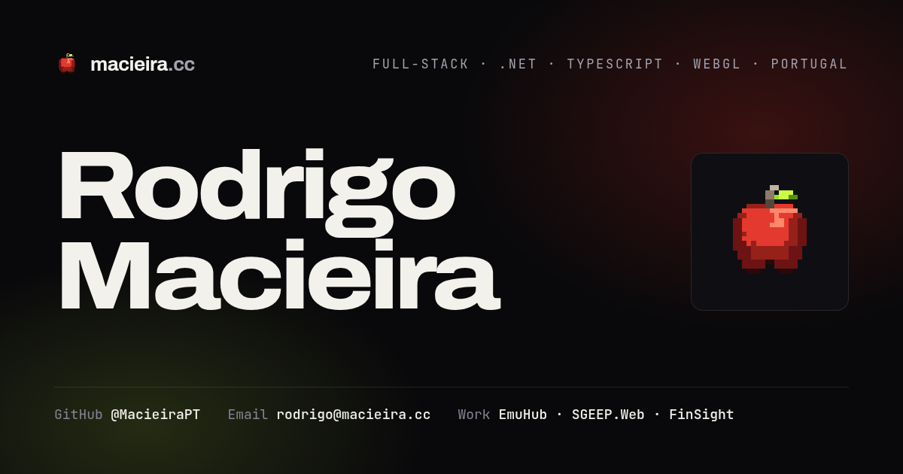

<div align="center">


# macieira.cc

**Personal portfolio and engineering case studies for Rodrigo Macieira.**

*Macieira* is Portuguese for **apple tree**, and my surname. The hero replaces decorative
scroll theatre with a crisp, draggable **8-bit / 16-bit Bayer-dithered 3D Apple** rendered on
a low-resolution WebGL target beside direct project work, stack capabilities, and engineering case studies.

[**↗ Visit the site**](https://macieira.cc) · [@MacieiraPT](https://github.com/MacieiraPT)

<br>



<br>


</div>

---

## Architecture Overview

- **Framework:** [SvelteKit](https://svelte.dev/docs/kit) (Svelte 5 runes + TypeScript `strict: true`), built with `@sveltejs/adapter-cloudflare` for Cloudflare Workers Static Assets (`wrangler.jsonc`).
- **Rendering:** Prerendered static HTML for [`/`](src/routes/+page.svelte), [`/work`](src/routes/work/+page.svelte), [`/work/emuhub`](src/routes/work/[slug]/+page.ts), `/work/sgeep`, and `/work/finsight`, plus a Worker endpoint at [`/api/github`](src/routes/api/github/+server.ts).
- **Bilingual (EN / PT-PT):** Typed reactive store in [src/lib/i18n](src/lib/i18n/index.svelte.ts) reading `?lang=pt` / `?lang=en`, `localStorage['lang:v2']`, and `navigator.languages`.
- **Retro 3D Apple Centerpiece:** Dynamically loaded Three.js (`three` split into its own async chunk) rendering faceted fruit, bark stem, and folded leaf geometry into a `NearestFilter` low-res `WebGLRenderTarget` with a custom 4×4 Bayer ordered-dither GLSL shader and silhouette outline blit pass in [retroAppleShader.ts](src/lib/webgl/retroAppleShader.ts) and [RetroAppleCanvas.svelte](src/lib/components/RetroAppleCanvas.svelte).
- **Edge-Cached GitHub Activity:** [`/api/github`](src/routes/api/github/+server.ts) caches upstream responses via Cloudflare edge cache (`s-maxage=1800`), uses an optional `GITHUB_TOKEN` Worker secret if configured, and falls back gracefully to [github-snapshot.ts](src/lib/data/github-snapshot.ts).

## Routes & Content

| Route | Purpose |
| --- | --- |
| `/` | Above-the-fold identity, interactive 8-bit/16-bit 3D Apple, **01 Selected Work**, **02 Background & Stack** (*Programador de Informática*, EQF Level 4), **03 Open Source & GitHub**, and **04 Contact**. |
| `/work` | Filterable archive of shipped software (`EmuHub`, `SGEEP.Web`, `FinSight`). |
| `/work/[slug]` | Detailed engineering case studies covering problem framing, constraints, architecture decisions, security controls, and measured outcomes from [`projects.ts`](src/lib/data/projects.ts). |
| `/api/github` | Cloudflare Worker endpoint returning normalized profile, repo, and 14-day activity data with automatic `GITHUB_SNAPSHOT` fallback. |

## Development

```bash
npm install
npm run dev       # Vite dev server on http://localhost:4321
npm run check     # Wrangler types check + svelte-kit sync + svelte-check
npm run build     # Production SSR + client + prerender + Cloudflare Worker build
npm run preview   # Local Cloudflare Worker runtime via wrangler dev
npm run og        # Regenerate static/assets/og.png & touch/PWA icons via Chromium
```

Optional environment variable for elevated `/api/github` upstream rate limits:

- `GITHUB_TOKEN` (Worker secret via `npx wrangler secret put GITHUB_TOKEN`), typed cleanly via [`src/env.ts`](src/env.ts). When unset, `/api/github` uses anonymous GitHub requests cached at the edge and drops cleanly to the curated snapshot if rate-limited.

## Graceful Degradation & Accessibility

- **Zero JS:** Prerendered HTML keeps the full page, inline pixel-art SVG apple, Selected Work cards, EQF 4 credential, and contact links completely legible.
- **No WebGL / Context Loss:** `RetroAppleCanvas.svelte` probes WebGL before importing `three`, leaving the crisp pixel-art SVG fallback visible when WebGL is unavailable.
- **`prefers-reduced-motion`:** Idle spin and subtle vertex grid snapping turn off automatically while pointer drag stays responsive.
- **Contrast & Native Scrollbars:** `--ink-faint` (`#858594`) clears WCAG AA contrast on both `#08080a` and `#0f0f13`/`#15151b` card surfaces; native browser scrolling and OS scrollbars are preserved.

## Credits

- Typefaces: [Archivo](https://fonts.google.com/specimen/Archivo) & [JetBrains Mono](https://www.jetbrains.com/lp/mono/) (OFL, self-hosted Latin subsets in [`static/assets/fonts`](static/assets/fonts)).
- Domain & code: [@MacieiraPT](https://github.com/MacieiraPT) (`rodrigo@macieira.cc`).
