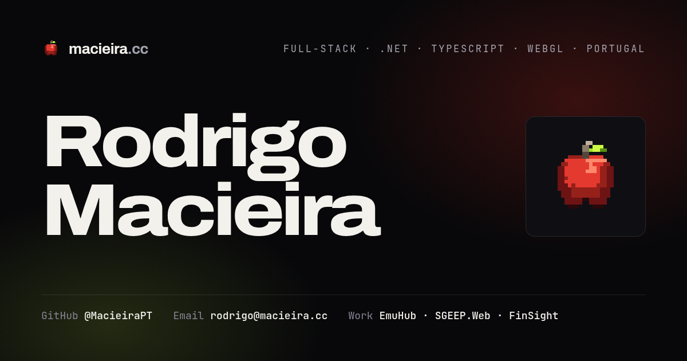

<div align="center">


# macieira.cc

**Personal portfolio and engineering case studies for Rodrigo Macieira.**

*Macieira* is Portuguese for **apple tree**, and my surname. The hero replaces decorative
scroll theatre with a crisp, draggable **8-bit / 16-bit Bayer-dithered 3D Apple** rendered on
a zero-dependency raw WebGL target beside direct project work, stack capabilities, engineering case studies, and a 1-page printable CV.

[**↗ Visit the site**](https://macieira.cc) · [@MacieiraPT](https://github.com/MacieiraPT)

<br>



<br>


</div>

---

## Architecture Overview

- **Framework:** [SvelteKit 3](https://svelte.dev/docs/kit) (Svelte 5 runes + TypeScript `strict: true`), **zero runtime dependencies**, built with `@sveltejs/adapter-cloudflare` for Cloudflare Workers Static Assets (`wrangler.jsonc`).
- **Prerendered Bilingual Routing (EN / PT-PT):** All 12 pages prerender as static HTML across `/` (EN) and `/pt` (PT-PT) via SvelteKit's `[[lang=lang]]` route tree, with localized `<html lang>`, self-referencing canonicals, reciprocal `hreflang`, auto-generated [`/sitemap.xml`](src/routes/sitemap.xml/+server.ts), zero-JS `EN`/`PT` links, and backwards-compatible `?lang=` redirects.
- **Zero-Dependency Raw WebGL Apple:** Dynamically loaded pure WebGL renderer (~5.3 kB gz, no Three.js) in [retroAppleShader.ts](src/lib/webgl/retroAppleShader.ts) and [RetroAppleCanvas.svelte](src/lib/components/RetroAppleCanvas.svelte) rendering faceted fruit, Catmull-Rom bark stem, and folded leaf geometry into a `NEAREST`-filtered offscreen FBO with 4×4 Bayer ordered dithering, 4 synchronized site/shader palettes (`Acid Orchard`, `Game Boy DMG`, `Amber CRT`, `1-Bit Mac`), 1px silhouette outline pass, and real local telemetry.
- **Edge-Cached GitHub Activity:** [`/api/github`](src/routes/api/github/+server.ts) caches upstream responses via Cloudflare edge cache (`s-maxage=1800`, 120s cached fallback on outages/rate limits), supports an optional `GITHUB_TOKEN` Worker secret, and degrades gracefully to [github-snapshot.ts](src/lib/data/github-snapshot.ts).
- **Strict Hash-Mode CSP:** SvelteKit `csp: { mode: 'auto' }` emits per-page script SHA-256 hashes (no `script-src 'unsafe-inline'`) paired with `/assets/boot.js` and edge framing headers in [`_headers`](_headers).

## Routes & Content

| Route (EN / PT-PT) | Purpose |
| --- | --- |
| `/` · `/pt` | Above-the-fold identity, interactive raw-WebGL 8-bit/16-bit 3D Apple with 4 retro palettes, **01 Selected Work**, **02 Background & Stack** (*Programador de Informática*, EQF Level 4), **03 Open Source & GitHub**, and **04 Contact**. |
| `/work` · `/pt/work` | Filterable archive of shipped software (`EmuHub`, `SGEEP.Web`, `FinSight`). |
| `/work/[slug]` · `/pt/work/[slug]` | Detailed engineering case studies covering problem framing, constraints, architecture decisions, security controls, and measured outcomes from [`projects.ts`](src/lib/data/projects.ts). |
| `/cv` · `/pt/cv` | Bilingual 1-page A4 print-to-PDF CV sheet with clean print typography. |
| `/sitemap.xml` | Prerendered bilingual XML sitemap generated from [`projects.ts`](src/lib/data/projects.ts). |
| `/api/github` | Cloudflare Worker endpoint returning normalized profile, repo, language, and 14-day activity data with cached `GITHUB_SNAPSHOT` fallback. |

## Development

```bash
npm install
npm run dev          # Vite dev server on http://localhost:4321
npm run check        # Fast svelte-kit sync + svelte-check
npm run check:all    # Wrangler types check + svelte-kit sync + svelte-check
npm run build        # Production SSR + client + prerender + Cloudflare Worker build
npm run preview      # Local Cloudflare Worker runtime via wrangler dev
npm run og           # Regenerate static/assets/og.png & touch/PWA icons via Chromium
```

Optional environment variable for elevated `/api/github` upstream rate limits:

- `GITHUB_TOKEN` (Worker secret via `npx wrangler secret put GITHUB_TOKEN`), typed cleanly via [`src/env.ts`](src/env.ts). When unset, `/api/github` uses anonymous GitHub requests cached at the edge and drops cleanly to the curated snapshot if rate-limited.

## Graceful Degradation & Accessibility

- **Zero JS:** Prerendered EN & PT HTML keeps every page, the EN/PT language switcher, mobile navigation links, inline pixel-art SVG apple, Selected Work cards, EQF 4 credential, and contact links completely usable.
- **No WebGL / Context Loss:** `RetroAppleCanvas.svelte` probes WebGL directly on `<canvas>` before importing the raw WebGL module, handles `webglcontextlost`/`webglcontextrestored`, and leaves the crisp pixel-art SVG fallback visible when WebGL is unavailable.
- **`prefers-reduced-motion`:** Idle spin and subtle vertex grid snapping turn off automatically while pointer drag stays responsive.
- **WCAG AA Contrast Across All 4 Themes:** Every foreground/surface pair across `orchard`, `dmg`, `amber`, and `mac1bit` clears `>= 5.0:1` contrast.

## Credits

- Typefaces: [Archivo](https://fonts.google.com/specimen/Archivo) & [JetBrains Mono](https://www.jetbrains.com/lp/mono/) (OFL, self-hosted Latin subsets in [`static/assets/fonts`](static/assets/fonts)).
- Domain & code: [@MacieiraPT](https://github.com/MacieiraPT) (`rodrigo@macieira.cc`).
